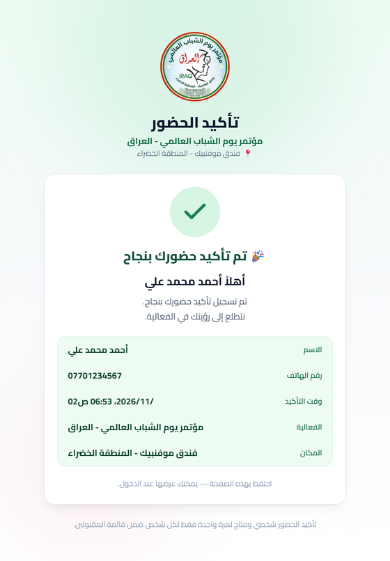
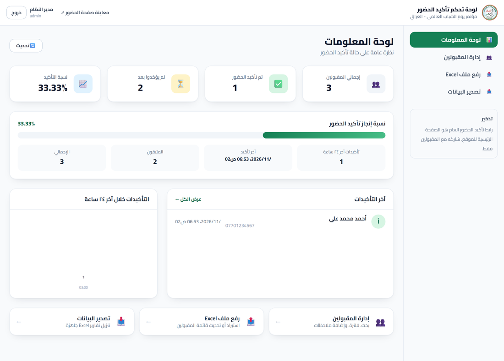

<div align="center">


# RSVP — Attendance Confirmation System

**A bilingual-ready, fully RTL Arabic web app for confirming event attendance from a pre-approved guest list.**

Guests confirm with nothing but their phone number. Organizers upload the approved list from
Excel, watch confirmations arrive live, and export clean reports.

[](https://www.python.org/)
[](https://fastapi.tiangolo.com/)
[](https://react.dev/)
[](https://vitejs.dev/)
[](https://tailwindcss.com/)
[](https://www.sqlite.org/)

</div>

---

## Screenshots

<div align="center">

| Guest page | After confirming |
| :---: | :---: |
|  |  |

**Admin dashboard**



</div>

> Screenshots use sample data only.

---

## Why this exists

Events with a vetted guest list need two things at once: a confirmation page simple enough that
anyone can use it on a phone in a few seconds, and a back office that never loses track of who is
actually coming. This app does both, and it refuses to invent people — **only phone numbers that
already exist in the uploaded list can ever be confirmed, and no record is ever created by the
public page.**

---

## Features

### For guests

- **One field.** Enter a phone number, tap confirm. No account, no password, no name to spell.
- **Flexible number formats.** `07XXXXXXXXX`, `+9647XXXXXXXX`, `00964…`, Arabic-Indic digits
  (`٠٧٧…`), spaces and dashes all resolve to the same person.
- **Clear outcomes.** Success shows the guest's name, phone, confirmation time, event and venue.
  A number that is not on the list is politely rejected.
- **Confirm once.** A second attempt shows the original confirmation time instead of
  creating a duplicate.
- **Works on any phone.** Responsive, full RTL, Arabic UI, large touch targets.

### For organizers

- **Excel import** with automatic column detection, data cleaning and phone normalization.
- **Dry-run preview** that reports exactly what would be imported — before anything is saved.
- **Live dashboard**: totals, confirmed, pending, confirmation rate, last 24h activity and recent
  confirmations.
- **Searchable table** with status filters, sortable columns and pagination. Search works across
  name and phone in any format.
- **Per-guest notes** the team can edit at any time.
- **Manual override** to confirm or un-confirm a guest from the panel.
- **Excel export** — all guests, confirmed only, or pending only — as a formatted workbook with a
  summary sheet.

---

## Tech stack

| Layer | Technology |
| --- | --- |
| Frontend | React 18, Vite 5, React Router 6, Axios, Tailwind CSS 3 (full RTL) |
| Backend | Python, FastAPI, SQLAlchemy 2, Pydantic v2 |
| Database | SQLite |
| Auth | JWT access tokens, PBKDF2-SHA256 password hashing |
| Excel | openpyxl (read and write) |

---

## Quick start

### Windows (one click each)

1. **`build-frontend.bat`** — installs frontend packages and builds the UI.
2. **`start-backend.bat`** — creates the virtual environment, installs dependencies, starts the API.

Then open <http://127.0.0.1:8000>. The backend serves the API and the built UI from a single port.

### Manual

**Backend**

```bash
cd backend
python -m venv .venv
.venv\Scripts\activate          # Linux/macOS: source .venv/bin/activate
pip install -r requirements.txt
copy .env.example .env          # Linux/macOS: cp .env.example .env
python -m uvicorn main:app --reload --port 8000
```

**Frontend**

```bash
cd frontend
npm install
npm run dev
```

The dev server runs on <http://localhost:5173> and proxies `/api` to the backend.

**Production build**

```bash
cd frontend
npm run build
```

This writes `frontend/dist`, which FastAPI serves automatically when present.

---

## First login

A default admin account is created on first run from the values in `backend/.env`:

| Field | Source |
| --- | --- |
| Username | `ADMIN_USERNAME` (default `admin`) |
| Password | `ADMIN_PASSWORD` |

> **Set a real password in `.env` before the first run.** The admin panel lives at `/admin/login`
> and is not linked from the public page. Change the password any time via
> `POST /api/auth/change-password`.

---

## Configuration

All settings live in `backend/.env` (copy from `.env.example`):

| Variable | Default | Purpose |
| --- | --- | --- |
| `EVENT_NAME` | — | Event title shown on the guest page |
| `EVENT_PLACE` | — | Venue shown on the guest page |
| `DATABASE_URL` | `sqlite:///./data/attendance.db` | Database location |
| `SECRET_KEY` | — | JWT signing key — **use a long random value** |
| `ACCESS_TOKEN_EXPIRE_MINUTES` | `720` | Admin session length |
| `ADMIN_USERNAME` / `ADMIN_PASSWORD` | — | Seeded on first run only |
| `ATTENDANCE_RATE_LIMIT` | `40` | Confirmation attempts per IP per window |
| `ATTENDANCE_RATE_WINDOW` | `300` | Rate-limit window in seconds |
| `LOGIN_RATE_LIMIT` | `8` | Login attempts per IP per window |
| `CORS_ORIGINS` | localhost | Comma-separated allowed origins |
| `TIMEZONE` | `Asia/Baghdad` | Timezone for display and exports |

> **Venue Wi-Fi warning.** Rate limits are per IP. If guests confirm over one shared network they
> all appear as a single address, so raise `ATTENDANCE_RATE_LIMIT` well above the expected guest
> count before the event. Behind a reverse proxy, restore the real client IP (for example
> `real_ip_header CF-Connecting-IP` with Cloudflare) or the limiter will see one address for
> everyone.

---

## Excel format

The first row must contain a name column and a phone column:

| الاسم | رقم الهاتف |
| --- | --- |
| أحمد محمد علي | 07701234567 |
| علي حسن كريم | 07801234567 |

- Alternative headers are recognized automatically in Arabic and English
  (`الاسم الكامل`, `الموبايل`, `Name`, `Phone`, `Mobile`, and more).
- The header row is located anywhere within the first 20 rows, so banners above it are fine.
- Accepted formats: `.xlsx`, `.xlsm`, `.csv` — up to 10 MB.
- Format the phone column as text so leading zeros survive (numeric cells are repaired anyway).
- **Phone number is the unique key.** It cannot repeat across two people.
- A ready-made template is downloadable from the import page.
- `python sample_data/generate_sample.py` builds a sample file for testing.

### Import modes

| Mode | Behaviour |
| --- | --- |
| **Preview (dry run)** | Parses the file and reports everything — saves nothing |
| **Append** | Adds new people, skips those already present, leaves confirmations untouched |
| **Replace** | Deletes every record (including confirmations) and imports the file |

The report returns total rows, imported, already present, duplicated within the file, invalid rows,
and a table naming each skipped row with its Excel row number and the reason.

---

## How confirmation works

1. The phone number is normalized — country codes, separators and Arabic-Indic digits all reduce to
   one canonical form.
2. The database is searched by that canonical number, which is the unique identifier for a guest.
3. The result is one of three states:

| State | Condition | Result |
| --- | --- | --- |
| `confirmed` | Number is on the list and was not confirmed before | Attendance recorded with a timestamp |
| `already_confirmed` | Number was confirmed earlier | Original timestamp returned, no new record |
| `not_found` | Number is not on the list | Rejected — **no record is created** |

### One confirmation per person

Enforced at two levels:

**Database (authoritative).** Confirmation is a conditional update
(`UPDATE … WHERE attendance_confirmed = false`), so a guest is counted exactly once even under
concurrent requests.

**Device (prevents confirming on behalf of others).** After a successful confirmation the result is
cached in `localStorage` and the form is hidden on that device — there is no "confirm someone else"
button.

That cache is **never trusted on its own**. On every page load the app re-checks the real state via
`GET /api/attendance/status`:

| Server says | Page does |
| --- | --- |
| `confirmed` | Keeps the lock, refreshes the details from the server |
| `not_confirmed` | Clears the lock and shows the form again |
| `not_found` | Clears the lock and shows the form again |
| unreachable | Shows the form — nobody is ever locked out |

So re-uploading the guest list, or un-confirming someone from the admin panel, immediately frees
that device.

> **Scope of this protection.** Phone-only confirmation is deliberately frictionless: anyone who
> knows an approved guest's number can confirm on their behalf. The guarantee the system does make
> is that **each guest is counted exactly once**. Strong identity proof would require SMS
> verification, which is not part of this project.

---

## API

### Public

| Method | Path | Description |
| --- | --- | --- |
| `GET` | `/api/health` | Service health |
| `GET` | `/api/attendance/event-info` | Event name and venue |
| `GET` | `/api/attendance/status?phone=…` | Read-only state of a number |
| `POST` | `/api/attendance/confirm` | Confirm attendance |

```jsonc
// POST /api/attendance/confirm
{ "phone": "07701234567" }

// 200 OK — the outcome is carried by `status`
{
  "status": "confirmed",            // confirmed | already_confirmed | not_found
  "message": "…",
  "name": "أحمد محمد علي",
  "phone": "07701234567",
  "confirmed_at": "2026-08-19T15:24:11",
  "event_name": "…",
  "event_place": "…"
}
```

### Auth

| Method | Path | Description |
| --- | --- | --- |
| `POST` | `/api/auth/login` | Sign in, returns a JWT |
| `GET` | `/api/auth/me` | Current admin |
| `POST` | `/api/auth/change-password` | Change password |

### Admin — requires `Authorization: Bearer <token>`

| Method | Path | Description |
| --- | --- | --- |
| `GET` | `/api/admin/statistics` | Totals, confirmed, pending, percentage |
| `GET` | `/api/admin/people` | List with `search`, `status`, `sort_by`, `sort_dir`, `page`, `page_size` |
| `GET` | `/api/admin/people/{id}` | Single guest |
| `PUT` | `/api/admin/people/{id}/note` | Create or edit a note |
| `PUT` | `/api/admin/people/{id}/attendance?confirmed=` | Manually set attendance |
| `POST` | `/api/admin/import-excel` | Import a file (`mode`, `dry_run`) |
| `GET` | `/api/admin/export-excel?scope=` | Export `all`, `confirmed` or `not_confirmed` |
| `GET` | `/api/admin/excel-template` | Download the blank template |
| `GET` | `/api/admin/recent-confirmations` | Latest confirmations |
| `GET` | `/api/admin/hourly-confirmations` | Last 24 hours, bucketed by hour |
| `DELETE` | `/api/admin/people?confirm=DELETE` | Delete every record |

Interactive documentation is served at `/api/docs`.

---

## Database

A single table, `people`:

| Column | Type | Notes |
| --- | --- | --- |
| `id` | integer | Primary key |
| `name` | text | As written in the Excel file |
| `phone` | text | Normalized for display |
| `name_normalized` | text | Search key — diacritics and letter variants folded |
| `phone_normalized` | text | **Unique** — the guest identifier |
| `attendance_confirmed` | boolean | Defaults to `false` |
| `confirmed_at` | datetime | UTC, set on confirmation |
| `admin_note` | text | Free text from the organizers |
| `created_at` | datetime | UTC |

Admin accounts live in `admins`. Timestamps are stored in UTC and rendered in `TIMEZONE`.

---

## Project structure

```
.
├── backend/
│   ├── main.py                 # App entry, CORS, SPA hosting, startup
│   ├── config.py               # Settings loaded from .env
│   ├── database.py             # Engine, session, Base
│   ├── models/                 # SQLAlchemy models (person, admin)
│   ├── schemas/                # Pydantic request/response models
│   ├── routers/                # attendance, auth, admin
│   ├── services/               # Excel import and export
│   ├── utils/                  # Normalization, security, rate limiting, time
│   └── requirements.txt
├── frontend/
│   ├── src/
│   │   ├── pages/              # Attendance, AdminLogin, Dashboard, People,
│   │   │                       # ImportExcel, ExportExcel
│   │   ├── components/         # Shared UI and admin layout
│   │   ├── services/           # API client, auth context, formatting
│   │   └── App.jsx
│   ├── public/                 # Logo and icons
│   └── package.json
├── sample_data/                # Sample file generator
├── docs/                       # Screenshots
└── *.bat                       # Windows helper scripts
```

---

## Deployment

Run the API behind a reverse proxy and serve the built frontend from the same origin.

1. Build the frontend (`npm run build`) and deploy the project to the server.
2. Create `.env` with a strong `SECRET_KEY`, a real `ADMIN_PASSWORD` and your domain in
   `CORS_ORIGINS`.
3. Run Uvicorn on a local port under a process manager such as systemd:

```ini
[Unit]
Description=Attendance confirmation system
After=network.target

[Service]
WorkingDirectory=/opt/attendance/backend
ExecStart=/opt/attendance/backend/.venv/bin/uvicorn main:app --host 127.0.0.1 --port 8010
Restart=always

[Install]
WantedBy=multi-user.target
```

4. Proxy it with nginx and terminate TLS:

```nginx
server {
    listen 443 ssl http2;
    server_name example.com;

    client_max_body_size 12M;   # Excel uploads — the 1M default rejects them

    location / {
        proxy_pass http://127.0.0.1:8010;
        proxy_set_header Host $host;
        proxy_set_header X-Real-IP $remote_addr;
        proxy_set_header X-Forwarded-For $proxy_add_x_forwarded_for;
        proxy_set_header X-Forwarded-Proto $scheme;
    }
}
```

**Deployment checklist**

- [ ] `SECRET_KEY` replaced with a long random value
- [ ] `ADMIN_PASSWORD` changed from the example
- [ ] `CORS_ORIGINS` set to the real domain
- [ ] `client_max_body_size` raised above 10 MB
- [ ] `ATTENDANCE_RATE_LIMIT` raised for venue Wi-Fi
- [ ] Real client IP restored if behind a CDN
- [ ] HTTPS certificate installed and auto-renewing
- [ ] `backend/data/` included in backups
